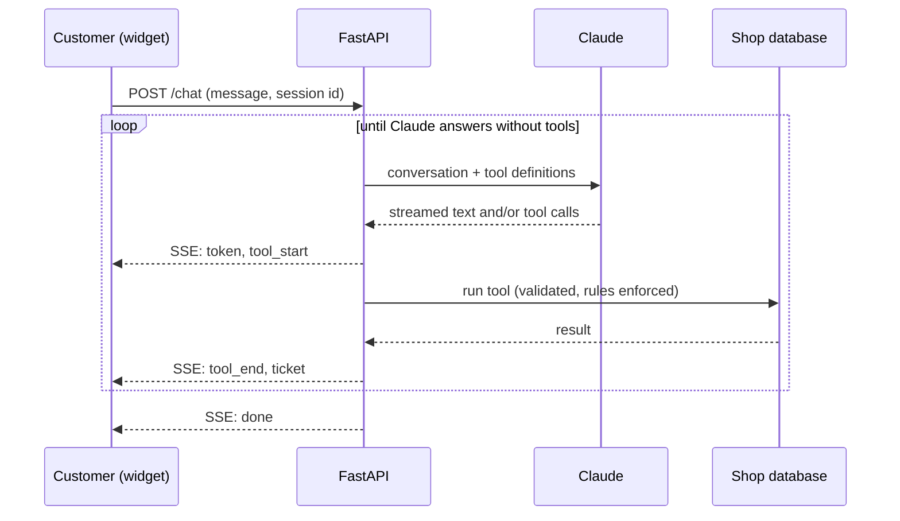

# Support Agent: AI customer support with tools

A customer support agent for an online shop. It answers in **Vietnamese or English**, looks up real orders, cancels them when the rules allow, answers policy questions from the help center, and opens a ticket for the human team when it can't solve the problem. It ships as a **chat widget you can add to any website with one line of code**.

Built with **Claude tool use, Python, FastAPI, SQLite, Next.js and TypeScript**.

> Demo video: _add your Loom link here_ · Live demo: _add your URL here_

## What it can do

| Tool | What it does | Guardrail enforced in code |
|---|---|---|
| `search_help_articles` | Finds shipping, returns, payment and warranty answers. Works with Vietnamese with or without accents | Agent answers policy questions only from these articles |
| `get_order` | Status, items, total, tracking | Needs order number **and** matching email. A wrong email and a missing order return the same answer, so order numbers can't be guessed |
| `cancel_order` | Cancels an order | Only while status is `processing`, and only with a matching email |
| `create_ticket` | Hands off to the human team with a written summary | Input validated (category, priority, email) before anything is saved |

The model decides *when* to use a tool. The code decides *whether it is allowed*. Business rules never depend on the prompt alone.

## How it works



- **Streaming agent loop** (`backend/app/agent.py`): Claude's reply streams token by token. If it asks for tools, they run and the results go back, for up to 6 rounds.
- **Strict tool schemas**: every tool uses `strict: true`, so arguments always match the schema, and they are validated again with Pydantic before running.
- **Sessions**: each chat keeps its history on the server. A failed turn is rolled back so the conversation never ends up in a broken state.
- **Safety limits**: caps on tool rounds, conversation length and stored sessions.

## Add the widget to a website

```html
<script src="https://YOUR-HOST/embed.js" data-lang="vi" data-color="#0f766e" async></script>
```

This adds a chat button in the bottom-right corner. `data-lang` is `vi` or `en` for the widget's labels (the agent itself replies in whatever language the customer writes). When the agent creates a ticket, the widget also sends a `support-agent:ticket` message to the host page, which the demo uses to show a live "support team inbox".

## Run locally

Requirements: Python 3.12+, Node 22+, and an [Anthropic API key](https://console.anthropic.com).

**Backend**

```bash
cd backend
python -m venv .venv && source .venv/bin/activate
pip install -r requirements-dev.txt
cp .env.example .env        # add your ANTHROPIC_API_KEY
uvicorn app.main:app --reload --port 8000
```

**Frontend**

```bash
cd frontend
npm install
cp .env.example .env.local
npm run dev
```

Open http://localhost:3000 and click the chat button. The page lists demo orders and things to ask.

**Or with Docker**

```bash
cp backend/.env.example backend/.env   # add your key
docker compose up --build
```

## Demo script (for a 2-minute video)

1. "Phí giao hàng là bao nhiêu?" shows a Vietnamese answer from the help center.
2. "Where is my order LH-1001?" The agent asks for the email. Give a wrong one first, then `linh.tran@example.com`.
3. "Tôi muốn hủy đơn LH-1002, email minh.nguyen@example.com" shows a confirmation, then the cancellation.
4. "My oak table from LH-1003 arrived scratched (sarah.lee@example.com)" creates a ticket that appears in the inbox panel.

## API

`POST /chat` with `{ "message": "...", "session_id": "..." }` (omit `session_id` on the first message). Streams SSE events:

| Event | Data |
|---|---|
| `session` | `{ session_id }` |
| `token` | `{ text }` |
| `tool_start` / `tool_end` | `{ name }` / `{ name, ok }` |
| `ticket` | `{ ticket_id, subject, category, priority }` |
| `done` / `error` | `{}` / `{ message }` |

`GET /sessions/{session_id}/tickets` lists the tickets created in one chat.

## Tests

```bash
cd backend && pytest -q     # tools and business rules, agent loop, sessions, error handling
cd frontend && npm test     # SSE parser and translations
```

Claude is mocked in tests, so they run offline in under a second.

## Adapting it for a real shop

- Replace `backend/app/db.py` with calls to the shop's real order system (Shopify, WooCommerce, Haravan, a custom API) inside the functions in `tools.py`.
- Send tickets to the team's real helpdesk or to email, Zalo or Slack.
- Move sessions from memory to Redis to run more than one server.
- Add rate limiting and a stronger identity check (for example a one-time code by email) before exposing it publicly, because anyone with the link can use your Claude credits.

## License

MIT
